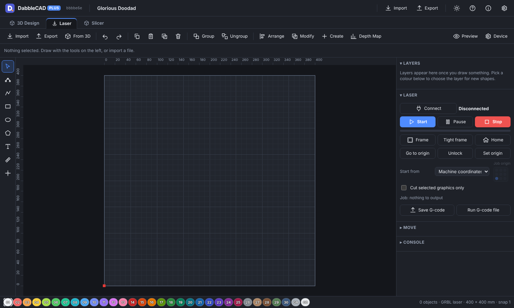

# UI guide

ElectroCAD's look and feel follows jonsole's DabbleCAD fork ([ADR-0007](adr/0007-look-and-feel-follows-the-dabblecad-fork.md)). The Schematic and Board editors are laid out like the fork's **Laser** workspace:



## Ported from the fork

Copy these rather than restyle them, and keep the attribution in `NOTICE`:

- **Design tokens and theming:** the `:root` and `:root[data-theme='light']` custom properties (`--bg`, `--panel`, `--panel-2`, `--panel-3`, `--border`, `--text`, `--muted`, `--accent`, `--accent-soft`, `--danger`, `--select`, `--shadow`), with `data-theme` on `<html>`. Dark is the default.
- **Type:** 13px/1.4 system UI stack (Segoe UI, system-ui…), with `ui-monospace` for coordinates and numbers.
- **Components:**
  - `.btn` variants (`-primary`, `-outline`, `-danger`, `-ghost`, `.active`), `.segmented`, `.mode-group` and `.sep`;
  - `.input` and `.select`, `.menu`, `.modal`, `.field`/`.row`, `.toast`, `.kbd` and `.mode-banner`;
  - the scrollbars.
- **DOM helper and icons:** the `h()` element builder, `button()`, `popupMenu()`, the dialogs, `toast()`, and the inline 24×24 stroke-icon table. ElectroCAD-specific icons are added to the same table in the same stroke style.
- **Shell pieces:** the top bar, workspace tabs (`.workspace-bar`, `.ws-tab`), the toolbar, and the boot splash.

## Screen layout

```
┌ Top bar (48) ─ logo · name · commit │ project name · save state ─────── Import · Export │ theme · help · about · settings ┐
├ Workspace tabs (36) ─ Schematic · Board · Gerber · Library ───────────────────────────────────────────────────────────┤
├ Toolbar (44) ─ file/edit actions │ undo/redo │ copy/paste/delete │ workspace actions … ───── Routing mode [Shove|Walk|Free] ┤
├ Hint bar (40) ─ "Nothing selected. Pick a tool on the left…" / active tool options (width, via, layer) ──────────────────┤
│ Tools │ rulers                                                         │ Side panel (344): collapsible ▾ SECTIONS     │
│ (46)  │ canvas                                                         │                                               │
│       │                                              [X 12.70 Y 5.08 mm] │                                               │
├ Bottom bar ─ chips (Sheets in Schematic, Copper layers in Board) ───────────────────── status: "12 components · 2-layer · grid 50 mil" ┤
```

| Area | Schematic | Board |
|---|---|---|
| **Tool palette** (left, icon buttons, active = accent) | Select, Wire, Net label, Global label, Power, No-connect, Text, Measure | Select, Route, Drag track, Via, Zone, Outline, Text, Measure |
| **Toolbar** | Import/Export, undo/redo, copy/paste/duplicate/delete, Rotate, Mirror, Annotate, ERC, Print | Import/Export, undo/redo, clipboard, Forward annotation, DRC, Fab output, plus the **Routing mode** `.mode-group` (Shove / Walkaround / Free) |
| **Right side panel** | **Part picker**, modelled on the fork's 3D Design shape panel (see below) | Collapsible uppercase sections like the Laser workspace's LAYERS / LASER: LAYERS (rows with a coloured chip, name, visibility, active), PROPERTIES, NET CLASSES, DRC |
| **Inspector** | Floating card at the top-right of the canvas, like the 3D Design inspector ("Box" card). It shows the selected Component's Reference designator, Value, MPN, Footprint and fields, and hides when nothing is selected | In the PROPERTIES section |
| **Bottom chips** (like the Laser workspace's colour palette) | One chip per Sheet; click to switch | One chip per Copper layer (and silk/mask); click to set the active layer |
| **Coordinate pill** | Bottom-left of the canvas, monospace, as in the Laser workspace | Same |
| **Mode banner** | Shows tool hints with `kbd` keys, e.g. "Wire: click to bend · Esc to finish" | e.g. "Routing: V via · / posture · Backspace undo segment" |

## Schematic Part picker

The Schematic's right-hand panel works like the fork's **3D Design shape panel**, with Parts in place of shapes:


- **Top row of tool buttons** (`.side-tools`, like Workplane / Ruler / Notes): **Netlist**, **ERC** and **Sheets**. Each opens a floating panel over the canvas; active means accent.
- **Category select** (`.side-filter`): All, Passives, Semiconductors, Connectors, ICs, Power, then one entry per user Library ("My parts").
- **Search** (`.side-search`): matches Part name, keywords and Value. It searches all categories when "All" is chosen.
- **Tile grid** (`.shape-grid` / `.shape-tile`, 3 columns): each tile is a thumbnail of the Part's Symbol (Unit A) drawn from its graphics, with the Part name underneath. Hovering highlights it in accent; a multi-Unit Part shows a small Unit count badge.
- **Placing:**
  - **Drag a tile onto the Sheet:** a ghost of the Symbol follows the cursor, snapped to the 50 mil grid. R rotates and X mirrors while dragging, releasing places it, and Esc or dropping outside the canvas cancels.
  - **Click a tile, then click on the Sheet:** places it. You stay in place mode for more copies until Esc.
  - **Enter or Space on a focused tile:** drops it in the middle of the view.
  - **Every drop:** creates a Component with the next free Reference designator and the Part's default Value, as one undo step.
  - **Multi-Unit Parts:** dropping one again offers the next unplaced Unit of the last Component (U1B…) before starting a new Component.
- **Footer** (`.side-foot`): **Import** (KiCad/Eagle libraries) and **New part** (opens the Library tab with an empty Part).

## Workspaces

There are four workspace tabs: **Schematic · Board · Gerber · Library**. Each keeps its own pan/zoom and selection when you switch away and back.

- **Board** has a segmented **2D | 3D** control at the right of its toolbar (like the fork's segmented control in the top bar). 3D swaps the canvas for the three.js board preview. The side panel and tabs stay.
- **Gerber** is the Fab output workspace. It generates and views the files in one place:
  - **Toolbar:** Generate, Download zip, Open Gerber files…, Top/Bottom view.
  - **Tool palette:** Pan, Measure.
  - **Canvas:** the generated (or opened) Gerber and Excellon layers, rendered from the files themselves.
  - **Side panel sections:** FAB PRESET, LAYERS (one chip per Gerber/drill file with visibility), OUTPUT (which files to include: Gerber, drill, BOM, pick-and-place), and CHECKS (DRC summary and missing-layer warnings).
  - **Bottom chips:** one per output layer.
- **Library** holds the user's Libraries and the Part, Symbol and Footprint editors:
  - **Side panel sections:** LIBRARIES (tree of libraries and Parts, with search), PART (prefix, default Value, Units, Preferred footprints and Pin maps), and PROPERTIES (the selected Pin, Pad or graphic).
  - **Toolbar:** a segmented **Symbol | Footprint** control picks what the canvas edits.
  - **Tool palette:** changes with that choice. For Symbol: Pin, Line, Rectangle, Circle, Arc, Text. For Footprint: Pad, Line, Rectangle, Circle, Arc, Text, Generator….
  - **Bottom chips:** one per Unit (Symbol) or per footprint layer (Footprint).

## Canvas colours

The canvas background is `--bg`. Grid lines and the paper/board frame use the Laser workspace's grid colours, and selection uses `--select`. Layer colours are fixed per layer and theme-aware:

| Layer | Dark theme | Note |
|---|---|---|
| F.Cu | `#e5484d` | red |
| In1.Cu | `#e5b84d` | amber |
| In2.Cu | `#46a758` | green |
| B.Cu | `#4f8cff` | blue (`--accent` family) |
| Silk | `#e7eaf0` | `--text` |
| Edge.Cuts | `#f2c94c` | |
| Ratsnest | `--muted` | thin |

In the schematic, Wires use the accent green `#46a758`, Symbol bodies use `--text` with a `--panel-2` fill, Pins use `--muted`, and labels use the accent colour. The light theme uses darker shades of the same hues.

## Logo

The logo follows the fork's mark: a rounded square in the brand colour with a white letter and an orange "splash" dot. For ElectroCAD that's an "E" whose dot sits on a short trace stub, like a via. The name sits next to the mark, with the short commit hash in monospace after it.
