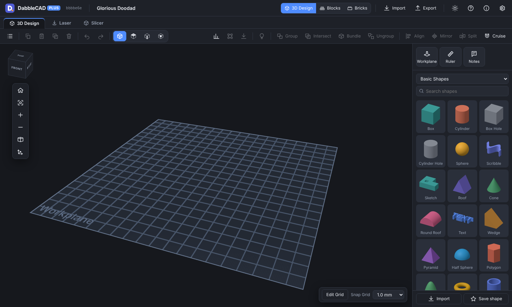

# UI guide

ElectroCAD's look and feel follows jonsole's DabbleCAD fork ([ADR-0007](adr/0007-look-and-feel-follows-the-dabblecad-fork.md)). The Schematic and Board editors are laid out like the fork's **Laser** workspace:


## Ported from the fork

Copy these rather than restyle them, and keep the attribution in `NOTICE`:

- **Design tokens and theming:** the `:root` and `:root[data-theme='light']` custom properties (`--bg`, `--panel`, `--panel-2`, `--panel-3`, `--border`, `--text`, `--muted`, `--accent`, `--accent-soft`, `--danger`, `--select`, `--shadow`), with `data-theme` on `<html>`. Dark is the default.
- **Type:** 13px/1.4 system UI stack (Segoe UI, system-ui…), with `ui-monospace` for coordinates and numbers.
- **Components:**
  - `.btn` variants (`-primary`, `-outline`, `-danger`, `-ghost`, `.active`), `.segmented`, `.mode-group` and `.sep`;
  - `.input` and `.select`, `.menu`, `.modal`, `.field`/`.row`, `.toast`, `.kbd` and `.mode-banner`;
  - the scrollbars.
- **DOM helper and icons:** the `h()` element builder, `button()`, `popupMenu()`, the dialogs, `toast()`, and the inline 24×24 stroke-icon table. ElectroCAD-specific icons are added to the same table in the same stroke style.
- **Shell pieces:** the top bar, workspace tabs (`.workspace-bar`, `.ws-tab`), the toolbar, and the boot splash.

## Screen layout

Projects live in the **Project store** and autosave (ADR-0011). The save state next to the project name reads "Saving…" or "All changes saved".
- **Logo:** opens **Your projects**.
- **File menu:** New project (Ctrl+N), Your projects…, Open file… (Ctrl+O, imports an `.ecad` into the store), Save as file… (Ctrl+Shift+S; a download in the browser). Ctrl+S saves to the store at once.
- **Import and Export** are only for KiCad and Eagle files.

### Your projects (home screen)

This is a full-window page over the app, ported from the fork's "Your designs" dashboard (`.dashboard`, `.dash-head`, `.dash-grid`, `.dash-card`).
- **Header:** the logo, then **Open file…**, **Projects folder** (desktop only) and **Back to project**.
- **Body:** a "Your projects" title and a card grid:
  - first, a dashed **Create new project** card;
  - then one card per Project, newest first, each with a 4:3 thumbnail, the name, the edited time ("5 min ago") and "12 components · 2-layer";
  - the open Project's card is outlined in accent.
- **Card actions:** clicking a card opens it. Its ⋯ menu has Open, Duplicate, Rename, Save as file… and Delete (with confirmation).
- **Keyboard:** cards are focusable and Enter opens them.

```
┌ Top bar (48) ─ logo · name · commit │ project name · save state ──── File · Import · Export │ theme · help · about · settings ┐
├ Workspace tabs (36) ─ Schematic · Board · Gerber · Library ───────────────────────────────────────────────────────────┤
├ Toolbar (44) ─ file/edit actions │ undo/redo │ copy/paste/delete │ workspace actions … ───── Routing mode [Shove|Walk|Free] ┤
├ Hint bar (40) ─ "Nothing selected. Pick a tool on the left…" / active tool options (width, via, layer) ──────────────────┤
│ Tools │ rulers                                                         │ Side panel (344): collapsible ▾ SECTIONS     │
│ (46)  │ canvas                                                         │                                               │
│       │                                              [X 12.70 Y 5.08 mm] │                                               │
├ Bottom bar ─ chips (Sheets in Schematic, Copper layers in Board) ───────────────────── status: "12 components · 2-layer · grid 50 mil" ┤
```

| Area | Schematic | Board |
|---|---|---|
| **Tool palette** (left, icon buttons, active = accent) | Select, Wire, Net label, Global label, Power, No-connect, Text, Measure | Select, Route, Drag track, Via, Zone, Outline, Text, Measure |
| **Toolbar** | Import/Export, undo/redo, copy/paste/duplicate/delete, Rotate, Mirror, Annotate, ERC, Print | Import/Export, undo/redo, clipboard, Forward annotation, DRC, Fab output, plus the **Routing mode** `.mode-group` (Shove / Walkaround / Free) |
| **Right side panel** | **Part picker**, modelled on the fork's 3D Design shape panel (see below) | Collapsible uppercase sections like the Laser workspace's LAYERS / LASER: LAYERS (rows with a coloured chip, name, visibility, active), PROPERTIES, NET CLASSES, DRC |
| **Inspector** | Floating card at the top-right of the canvas, like the 3D Design inspector ("Box" card). It shows the selected Component's Reference designator, Value, MPN, Footprint and fields, and hides when nothing is selected | PROPERTIES section: the same Component fields, including **Footprint**, plus position, rotation, side and lock. A Footprint change from either inspector swaps the Footprint in place on the Board at once (ADR-0008) |
| **Bottom chips** (like the Laser workspace's colour palette) | One chip per Sheet; click to switch | One chip per Copper layer (and silk/mask); click to set the active layer |
| **Coordinate pill** | Bottom-left of the canvas, monospace, as in the Laser workspace | Same |
| **Mode banner** | Shows tool hints with `kbd` keys, e.g. "Wire: click to bend · Esc to finish" | e.g. "Routing: V via · / posture · Backspace undo segment" |

## Schematic Part picker

The Schematic's right-hand panel works like the fork's **3D Design shape panel**, with Parts in place of shapes:



- **Sheets, Netlist and ERC** are not in the picker: they are a group of icon-only buttons on the toolbar, after Fields. Each opens a floating card over the canvas; a lit button means its card is open.
- **View button** next to the category select, like Explorer's View menu: **Icons** (the tile grid), **Small icons** (a small thumbnail with the name beside it, two columns), **List** (one row each) and **Details** (a table of Name, Category, Value, Units and Fp, sorted by clicking a heading). Every view drags, clicks and drops the same way.
- **Tree** (the same menu): **Group by category** (the default), **Group by manufacturer** or **No groups**. Each group has a header with a chevron and a count; clicking it folds or unfolds the group. While searching, every group with a match is open. Manufacturers come from the Library (Generic for parts everyone makes); like the category, they stay in the Library and aren't copied into Projects. The view, grouping and folded groups are remembered in this browser.
- **Category select** (`.side-filter`): All, Passives, Semiconductors, Connectors, ICs, Power, then one entry per user Library ("My parts").
- **Search** (`.side-search`): matches Part name, keywords and Value. It searches all categories when "All" is chosen.
- **Tile grid** (`.shape-grid` / `.shape-tile`, 3 columns): each tile is a thumbnail of the Part's Symbol (Unit A) drawn from its graphics, with the Part name underneath. Thumbnails show just the Symbol's shape (pin names and numbers are unreadable at tile size). Hovering highlights it in accent; a multi-Unit Part shows a `×5` Unit count badge at the top right.
- **Placing:**
  - **Drag a tile onto the Sheet:** a ghost of the Symbol follows the cursor, snapped to the 50 mil grid. R rotates and X mirrors while dragging, releasing places it, and Esc or dropping outside the canvas cancels.
  - **Click a tile, then click on the Sheet:** places it. You stay in place mode for more copies until Esc.
  - **Enter or Space on a focused tile:** drops it in the middle of the view.
  - **Every drop:** creates a Component with the next free Reference designator and the Part's default Value, as one undo step.
  - **Multi-Unit Parts** (#10, ADR-0005), e.g. an LM324: each click places one Unit. The next click offers the next unplaced Unit of an existing Component of that Part (gaps first, on any Sheet), then Unit A of a new Component once all are down. A strip at the top of the canvas shows the Component's Units: placed ones are struck through, the next one is lit, and "New U2" starts a new Component. Click a letter to place a different Unit. The ghost and the hint show what the next click places (`U1B`).
  - **Units in the inspector:** a Unit select swaps a placed Symbol to any Unit not placed elsewhere (gate swap), and a note lists the Units not placed yet. Deleting one Unit keeps the Component; deleting its last Unit removes it. All Units share the Component's one Footprint.
  - **Multi-Unit Parts:** dropping one again offers the next unplaced Unit of the last Component (U1B…) before starting a new Component.
- **Footprint row** (under the tiles, above the footer): hovering a tile, or the last tile clicked or dragged, shows the Part's Preferred footprints as chips, such as `0402 · 0603 · 0805 · 1206 · THT`, with a small pad preview on hover. The chosen chip applies to the next drop and is remembered per Part. The default is the one chosen last for that Part in this session, otherwise the Part's first Preferred footprint (0805 for chip parts). Chips are in size order; package parts show their package (`SOIC-14`, `DIP-14`, `SOT-223`). "Other…" opens a footprint search that can choose any Footprint, which then uses the identity Pin map.
- **Footer** (`.side-foot`): **Import** (KiCad/Eagle libraries) and **New part** (opens the Library tab with an empty Part).

### Starter Library

Generated by `library/footprints.js` and `library/starter.js` (#12); no third-party library is bundled. Footprints use IPC-7351 nominal land patterns and KiCad's names, so exports and imports line up.

| Category | Parts | Preferred footprints |
| --- | --- | --- |
| Passives | Resistor, Capacitor, Capacitor (polarised), Inductor | 0402, 0603, 0805, 1206 and a THT one (axial, disc, radial) |
| Semiconductors | LED, Diode, NPN (BC847), PNP (BC857), N-MOSFET (2N7002) | chip sizes + THT (LED 5 mm, DO-41); SOT-23 |
| Connectors | Conn_01x01–01x10, Conn_02x02–02x10 | 2.54 mm pin headers |
| ICs | LM324 (4+1 Units), LM358 (2+1), NE555, 74HC00 (4+1) | SOIC and DIP |
| Power | AMS1117-3.3 | SOT-223 (tab = pin 2) |

"Other…" also offers SOT-23-5 and QFN-16/20/24/32 packages, and every footprint above.

## Drawing Wires

The Wire tool (W) draws orthogonal runs with one corner between clicks.
- **The corner follows the direction you're already going:**
  - after a vertical run, the next run starts vertical, and after a horizontal run it starts horizontal;
  - the first run continues an existing Wire it starts from, or leaves straight out of the Pin it starts on.
- **If that would run through another Pin,** the corner goes the other way.
- **`/`** flips the corner for the rest of the Wire.

**Showing connections** (Settings → Schematic display; app settings, not per Project):
- **Connected Pins** (option, **off** by default): a Pin with a Wire on its tip, or touching another Pin, draws in the Wire colour.
- **Bare Pins** (option, on by default): a Pin with nothing on it gets a small open circle at its tip.
- **Junctions:** a dot where Wires really connect (a T-join, or three or more ends).
- **Crossings** (option, on by default): where a horizontal and a vertical Wire cross without connecting, the horizontal one draws a small semicircle **hop** over the other.

## Labels, Power symbols and Sheets

- **Net label (L)**, **Global label (Ctrl+L)**, **Power symbol (P)** and **Ground (G)** are tools in the left palette. A ghost follows the cursor; R turns it. Clicking a Pin, a Wire (end or middle) or a grid point opens a name box there; Enter places, Esc cancels. Ground goes down at once as GND, and a Power symbol goes down at once with the last power net used (+5V the first time). Double-click a power symbol's name to pick another net: a drop-down under the name box lists every power net (+3V3, +5V, VCC… and any the Project uses, so a voltage typed once is offered on every power symbol), narrowing as you type; arrow keys and Enter or a click choose. The next Power symbol then uses that net. The inspector has the same list as a Power net select, plus a box for a new net. (Not a `<datalist>`: browsers hide datalist choices that don't match the text already in the box.) A name with spaces is refused in the box, like a bad Reference.
- The name box offers the net names already in the Project. After a Net label the next one offers the name with its number bumped (D0 → D1).
- Text stays readable: Net and Global labels turned 180° or 270° read left-to-right or bottom-to-top, sitting on the other side of their point. Power symbols turn freely with upright text.
- Labels select, move, copy, rotate and delete with everything else. A label sitting on a Wire that moves goes with it. Double-click a label to rename it. The inspector edits the name, whether it joins on this sheet only or every sheet, and its rotation.
- Names match regardless of case (ADR-0013): `+3v3` and `+3V3` are one Net. Typing a name that differs from an existing Net only by case stores the existing spelling and says so in a toast. Mixed spellings from an import are kept on the labels; the Net shows the most used one, and ERC (#11) warns about them.
- Net names: Power symbol beats Global label beats Net label beats the generated `Net-(R1-Pad2)`. Local labels named alike on two Sheets are two Nets, shown as `Sheet 1/EN` and `Sheet 2/EN`. Two different names on one Net are kept for ERC (#11).
- **Sheets** are flat. The bottom bar has a chip per Sheet (click to switch, double-click to rename) and a + to add one after the current Sheet. The Sheets icon on the toolbar opens a card listing them with rename, move up/down and delete (the last Sheet stays). Each is one undo step; deleting a Sheet takes its parts with it and says so in a toast.

## Markup, title block and sheet sizes

- **Markup tools** in the palette, after No-connect. Markup never connects to Wires or Pins. Points snap to half a grid (25 mil).
  - **Text (T):** click and type; Enter finishes, Shift+Enter starts a new line. Double-click a note to edit its raw text.
  - **Line (I):** click points; double-click or Enter finishes.
  - **Rectangle (B):** click two corners. It starts dashed, for boxing a section.
  - **Circle (C):** click the centre, then the edge.
  - **Arc (A):** click the start, a point on the arc, then the end.
- **Editing:** markup selects, moves, copies, rotates (R; text turns between 0° and 90°), deletes and box-selects with everything else.
- **Inspector:**
  - text: content, size, alignment, rotation, bold, italic;
  - lines and shapes: solid, dashed or dotted, arrows at either end of a line, and a light fill for rectangles and circles.
- **Colour:** markup uses the theme's **Notes and markup** colour.
- **Text variables:** `${TITLE}`, `${COMPANY}`, `${AUTHOR}`, `${REV}`, `${DATE}`, `${COMMENT}`, `${SHEET_NAME}`, `${SHEET_NUMBER}`, `${SHEET_COUNT}` and `${PROJECT}` are drawn filled in. The raw text is what you edit, and an unknown variable is left as typed.
- **Title block:** the bottom-right corner of every Sheet shows the title (the Project name when empty), the Sheet name, "Sheet n of N", company, revision, date, author and comment, in the theme's sheet-edge colour.
- **Sheet setup** opens by double-clicking the title block, or from **Sheet setup…** in the right-click menu on empty canvas. It sets:
  - this Sheet's paper size (A4, A3, A2, Letter, Tabloid) and orientation; the canvas frame and Home follow it, and Print (#14) will use it;
  - the Project's title block fields.

## Print and export

**Print** (toolbar, or Ctrl+P) opens a dialog with a live preview of the first page:

- **Sheets:** all of them, or one.
- **Colours:** ElectroCAD Light (the default), Classic paper, or black and white. They don't follow the editor's theme.
- **Export PDF:** the chosen Sheets in one file, each page at its Sheet's paper size, with a border and the title block. Text uses the standard Helvetica font. Characters it can't show become `?`, except Ω, which is written "Ohm". Open the PDF in any viewer to print it.
- **Export SVG:** one Sheet per file, at its paper size in millimetres.

Output is drawn by the editor's own drawing code through vector back ends (`print/vector.js`), so it matches the screen. Editor-only marks (unconnected pin rings, ERC markers, selection) are left out.

## No-connects and ERC

- **No-connect (Q)** in the tool palette: click a Pin tip to mark it as left open on purpose (a cross in the theme's No-connect colour); click a marker to remove it. Markers move, copy and delete with their part, and can be selected and deleted on their own.
- **ERC** (the check icon in the toolbar's card group) opens a floating card that is **live**: it reruns after every change while open. The header counts errors and warnings ("2 errors · 1 warning", or "No problems").
- **Filter bar** under the header: **Errors**, **Warnings** and **Info** chips, each with its count, show or hide that kind (all on by default); a search box (`Part or net, e.g. U1 or VCC`) keeps the rows that involve a part or net whose name starts with what is typed, regardless of case (`r1` finds R1 and R10, `u1a` finds U1A, `vc` finds VCC). Esc in the box clears it. The canvas markers follow the filter.
- **Rows** come errors first (a red dot), then warnings (an amber diamond), then Info (a blue ring: pins marked no-connect, for review), with the Sheet's name when there are several Sheets. Clicking a row switches to its Sheet, zooms to it and rings it on the canvas. While the card is open every problem on the Sheet has a small marker.
- **Fixes:** a row with a fix has a button, e.g. **Rename to GND** for mixed spellings. It applies the fix as one undo step.
- **Rules** (`core/erc.js`, a pure function of the Project):

| Rule | Severity |
| --- | --- |
| A Pin isn't connected and isn't marked no-connect | error |
| Two outputs drive one Net | error |
| A power input has nothing supplying its Net (a Power symbol counts as the supply) | error |
| One Net has two different names | error |
| A Pin has no matching Pad on the Component's Footprint | error |
| A multi-Unit part's power Unit isn't placed | error (other Units: warning) |
| One name in mixed case (`GND`/`gnd`, ADR-0013) | warning, with a Rename fix |
| A Net reaches a single Pin | warning |
| A no-connect marker on a connected Pin, or on no Pin | warning |
| A Component has no Footprint | warning |
| Fields that couldn't find a free spot | warning |
| A Pin marked no-connect | info |

## Selecting and moving

- **Selecting:** click to select, Shift-click to add or remove an item, and drag on an empty canvas to box-select. Dragging **left to right** takes only items fully inside the box (solid outline); **right to left** takes anything the box touches (dashed outline). Ctrl+A selects all.
- **Moving:** drag a selected item to move the whole selection, with a live preview. Arrow keys nudge by one grid step, or ten with Shift. Every move is one undo step.
- **Wires follow what moves and stay square:**
  - a Wire whose both ends move goes with them;
  - a Wire with one moving end stretches. If its far end is a plain corner, the corner slides along so an L stays an L; otherwise the original run stays on its line, so T-joins onto it stay connected, and a new corner reaches the moved end;
  - a Wire T-joined onto a Wire that moves goes along with it.
  - a dragged Wire whose end sits on a Pin of a part that isn't moving stays on the Pin: a short run (with a corner if needed) joins them.
- **Connectivity never changes when you move things.**
- **Tidying on release:** when you release a drag (and after nudging, moving from the inspector or drawing a Wire), the Wires are tidied in the same undo step:
  - straight runs that meet end to end are joined, unless a Pin, a third Wire or a Wire passing through connects there;
  - runs lying on top of each other on the same line become one, so no segment is left hidden under another;
  - zero-length runs and duplicates are removed.
  This never changes connectivity.
- **Copy, paste, duplicate:** Ctrl+C, Ctrl+V (pastes under the cursor) and Ctrl+D (a copy four grid steps away). Pasted Components get the next free Reference designators and keep their Value, Footprint and Field style. Wires between copied parts come along.

## Editing fields on the canvas

- **Double-click to edit:** double-click a Reference designator or Value on the canvas and an edit box opens over the text, with the text selected.
  - **Enter**, or clicking away, saves as one undo step. **Esc** cancels.
  - A Reference that is taken, empty or has spaces is refused: Enter shows a red tip and keeps the box open; clicking away drops the edit with a short message.
  - The Value is edited as typed, even when the Field style shows it differently (for example RKM `4k7`).
  - With one-line styles ("R1 10k"), the half you double-click decides which field you edit.
- **Single click** on a field selects its part.

## Schematic inspector

The inspector is a floating card at the top right of the canvas, like the fork's 3D Design inspector. It stacks above the Netlist panel when both are open, and hides when nothing is selected.

- **One part selected:**
  - the title shows the Reference designator and the Part name;
  - **Reference** must be unique, with no spaces; a clash is refused with an inline message;
  - **Value**;
  - **Footprint:** Preferred footprints first, then *Other footprints (pins map by number)*;
  - **Field style:** "Project default" or any style;
  - **X / Y** in mm, snapped to the grid, with Wires following;
  - **Rotation** and **Mirror**;
  - collapsible **Ordering** (manufacturer and MPN) and **Custom fields** (add, edit, remove).
- **Several items selected:** the count, the selected references, a shared **Field style**, and Rotate, Mirror and Delete.
- **Editing:** every change is one undo step, and the card follows undo and redo.

### Moving and sizing the cards

The inspector, Sheets and Netlist cards start docked in a column at the top right, like DabbleCAD's inspector. Each card moves on its own: drag its header to float it anywhere over the canvas, and drag its bottom-right corner to resize it (width 250–520 px). A floating card comes to the front when touched, stays fully inside the canvas, and its place and size are remembered in this browser. Double-click an empty part of a card's header to dock it again. As in DabbleCAD, the inspector's header has icon buttons for the selection: Rotate, Mirror (parts only), Duplicate and Delete.

The Part picker draws each part on the Schematic colour theme's paper colour, so a tile looks like the part on the sheet.

## Field styles

- **Where styles are chosen:**
  - **Picker footer:** a **Field style** select sets the Project default. New Components use it, and so do existing Components that have no style of their own.
  - **Inspector:** selecting Components and picking a style there applies it to just those Components. "Project default" clears the override.
- **Managing styles:** Settings → Field styles has the same duplicate, edit, import and export flow as Colour themes.
  - The editor has a placement list you can reorder for horizontal and for vertical Symbols, checkboxes for which fields show, text size, bold, italic and gap, and the Value format.
  - A live preview shows a few parts in a crowded group.
- **Placing fields:** they move automatically as you work. Dragging a field (press on its text, not the part) moves just that field and pins it, snapped to a quarter grid, one undo step per drag. In a one-line style the half you grab comes out on its own.
  - A pinned field keeps its place relative to its part when the part moves, rotates or mirrors; the text stays upright. Other fields keep clear of it.
  - While its part is selected, a pinned field shows a small pin glyph and a faint dashed line to the part. The inspector says how many fields were moved by hand.
  - **Re-apply style** (in the Fields menu, the inspector and the right-click menu) unpins the selected parts' fields so the style places them again.
- **Right-click menu** (as in DabbleCAD): a right-click that doesn't pan opens Copy, Paste, Duplicate, Delete, Rotate, Mirror and Re-apply style for what's under the cursor, or Paste, Select all and Fit on empty canvas. Right-drag still pans.
- **Crowded spots:** a field that can't find a free spot gets a small amber triangle, a note in the hint bar, and an ERC warning ("R7 fields overlap C3").

## Board: layer stack and Outline

The Board tab (#15) edits the board's layer stack and its Outline. Footprints, Tracks and Zones come with their tickets.

- **LAYERS section.**
  - At the top: a **2 layers | 4 layers** segmented control and a board-thickness select (0.8–2.0 mm).
  - Going back to 2 layers is refused, with a toast, while Tracks or Zones are on In1.Cu or In2.Cu.
  - One row per layer, using KiCad names: copper (F.Cu, In1.Cu, In2.Cu, B.Cu), then silk, mask, paste, courtyard and fab for each side, then Edge.Cuts.
  - Each row has a coloured chip, the layer's name, and an eye button that shows or hides the layer.
  - Click a row to make that layer the **active layer**. The active layer is always shown.
  - **Show all** and **Only active** set every layer's visibility at once.
  - Layer colours come from the Board colour theme (Settings → Colours).
  - Visibility is remembered per browser.
- **Bottom chips:** the copper layers and Edge; click one to make it the active layer.
- **Outline tools** (on the palette, below the routing tools). Picking one makes Edge.Cuts the active layer. Everything snaps to the 0.5 mm grid.
  - **O, Outline rectangle:** click two corners. **Corner radius** in PROPERTIES rounds the corners of new rectangles; a rounded rectangle is stored as four lines and four arcs.
  - **P, Outline polygon:** click each corner. **A** makes the next side an arc: click a point it passes through, then where it ends. **Backspace** removes the last corner. Clicking the first corner closes the polygon; a ring marks it under the cursor.
  - **C, Circle:** click the centre, then the edge. Use it for a round board or a mounting hole.
  - The shape follows the cursor as a dashed preview. **Esc** cancels it, and a second Esc returns to Select.
- **M, Measure:** click two points. A label shows the distance and dx/dy in mm.
- **Select (V):**
  - Click an outline shape to select it; Shift-click adds to the selection.
  - Drag to move the selection, or nudge it 0.5 mm with the arrow keys.
  - **Del** deletes it.
  - PROPERTIES shows the selected shape: width and height for a rectangle, diameter for a circle, end points for a line or arc.
- **Outline state** is always shown at the bottom of PROPERTIES:
  - when closed: "Outline closed · 50 × 40 mm · 1 cut-out";
  - when not: a red note saying where it is open. Each loose end gets a red ring on the canvas.
  - A loop inside another loop is a **cut-out**, and the board is shaded inside its loops, leaving cut-outs clear.
- **Home** fits the board once there is an Outline.
- Each tab keeps its own pan and zoom.

## Workspaces

There are four workspace tabs: **Schematic · Board · Gerber · Library**. Each keeps its own pan/zoom and selection when you switch away and back.

- **Board** has a segmented **2D | 3D** control at the right of its toolbar (like the fork's segmented control in the top bar). 3D swaps the canvas for the three.js board preview. The side panel and tabs stay.
- **Gerber** is the Fab output workspace. It generates and views the files in one place:
  - **Toolbar:** Generate, Download zip, Open Gerber files…, Top/Bottom view.
  - **Tool palette:** Pan, Measure.
  - **Canvas:** the generated (or opened) Gerber and Excellon layers, rendered from the files themselves.
  - **Side panel sections:** FAB PRESET, LAYERS (one chip per Gerber/drill file with visibility), OUTPUT (which files to include: Gerber, drill, BOM, pick-and-place), and CHECKS (DRC summary and missing-layer warnings).
  - **Bottom chips:** one per output layer.
- **Library** holds the user's Libraries and the Part, Symbol and Footprint editors:
  - **Side panel sections:** LIBRARIES (tree of libraries and Parts, with search), PART (prefix, default Value, Units, Preferred footprints and Pin maps), and PROPERTIES (the selected Pin, Pad or graphic).
  - **Toolbar:** a segmented **Symbol | Footprint** control picks what the canvas edits.
  - **Tool palette:** changes with that choice. For Symbol: Pin, Line, Rectangle, Circle, Arc, Text. For Footprint: Pad, Line, Rectangle, Circle, Arc, Text, Generator….
  - **Bottom chips:** one per Unit (Symbol) or per footprint layer (Footprint).
  - **What works today (#13, Symbol):**
    - **LIBRARIES** lists your Libraries (a gear menu on each: New part here, Rename, Delete) and the read-only Built-in Library. Clicking a Part opens it; a Built-in Part opens as a copy that Save puts in your Library.
    - **PART** edits the name, prefix, default Value, category, manufacturer, keywords, Units and Preferred footprints (any generated Footprint; Pin n goes to Pad n). A red box lists what stops the Part being saved: no name, a bad prefix, a Unit without Pins, a Pin number used twice, an off-grid Pin, or a Preferred footprint missing a Pad.
    - **PROPERTIES** edits the selected Pin (number, name, direction, length in grid steps, electrical type) or graphic (fill, line width; text and size).
    - **Tools:** Select (V), Pin (P: click a grid point; the Pin gets the next free number and points into the body), Line (L), Rectangle (B), Circle (C), Arc (A: start, a point on the arc, end) and Text (T). Pins snap to 50 mil, graphics to 25 mil. R turns the selected Pins, Del deletes, arrow keys nudge.
    - **Units:** a bottom chip per Unit, + adds one with a copy of the current body.
    - **Saving:** **Save** (Ctrl+S) writes the Part to its Library and raises its version when it changed. Saved Parts appear in the Schematic picker straight away; each Library is also an entry in the picker's category select. Placing one records its Library origin (`library/part@version`).
    - **Undo:** Ctrl+Z in the Library tab undoes Part edits only, not the Project.
    - **The picker's New part** opens the Library tab with a new Part, in "My parts" (made for you if you have no Library yet).
    - **Footprint** editing is #19.

## Agents (MCP)

- **Settings → Agents:** an "Allow AI agents (MCP)" toggle (off by default), the localhost URL, the token (copy, regenerate), and copy-paste config snippets for Claude Desktop and Claude Code.
- **Top bar pill:** when an Agent is connected, an accent pill ("Agent connected") sits next to the save state. Clicking it opens the Agent activity panel.
- **Agent activity panel:** a floating panel, styled like the fork's dialogs, listing each tool call (time, tool, summary such as "place R1 (Resistor 0805)", result) with an Undo button. Edits also show the fork's toast briefly.

## AI chat

- **Opening it:** an **AI** button (sparkle icon) in the top bar toggles a **floating chat window**, styled like the fork's floating panels (`--panel`, `--border`, `--shadow`, radius 10). The window can be moved by its header and resized from its corners. Its position, size and open state are remembered, and it is available in every Workspace.
- **Header:** the provider and model (a click opens a quick model switch), an **Ask before edits** toggle, New chat, and Close.
- **Message list:** user messages and streamed replies. Each tool call shows as a compact chip such as "⚙ place_component R1 · Resistor 0805 ✓", which expands to show inputs and results. Edits made by a reply are grouped under it with an **Undo this reply** button. With Ask before edits on, proposed edits appear as **Edit cards** with Apply / Skip and an Apply all row.
- **Input:** a multi-line box (Enter sends, Shift+Enter adds a new line), an **Attach view** button (adds a canvas screenshot thumbnail), and a Stop button while streaming.
- **Footer:** a muted line, "Sends a Project summary and tool results to <provider>".
- **Settings → AI:**
  - a provider select (Anthropic, OpenAI, Google Gemini, Local / OpenAI-compatible);
  - an API key field with show/hide and "Test connection";
  - the model select, filled from the provider;
  - effort (Anthropic) or temperature (others) where the provider supports it;
  - the base URL for Local;
  - "Remember on this device" (browser only, with its warning).
  When no key is set, the chat window shows a one-click "Set up AI" prompt instead of the input.

## Canvas colours and colour themes

Canvas colours come from a **Colour theme**, chosen separately for the **Schematic** and the **Board** in Settings → Colours. The UI's dark/light theme only styles the chrome.

- **Who uses which theme:**
  - the Library tab's Symbol editor uses the Schematic theme;
  - its Footprint editor uses the Board theme;
  - the Gerber tab uses the Board theme's layer colours.
- **Built-in themes:**
  - **Match app** (the default for both): the ElectroCAD Dark colours when the UI is dark and ElectroCAD Light when it is light, shown in the tables below.
  - **Classic paper** (Schematic only): a white sheet with a light grey grid, dark-red Symbol bodies on a pale yellow fill, green Wires, blue Net labels and black text. This is the traditional printed-schematic look, and it stays light even in a dark UI.
- **Custom themes:**
  - **Duplicate** any theme, then change any colour with a colour picker. A live preview canvas shows the change.
  - **Rename**, **Delete**, and **Reset** a colour to the theme you duplicated from.
  - **Export** a theme to a `.json` file and **Import** one to share it.
  - Custom themes are stored with the app settings (desktop `settings.json`, browser storage), never in the Project file.
  - Built-in themes are read-only; editing one starts by duplicating it.
- **Rulers** are app chrome, so they follow the app's dark/light theme rather than the canvas theme.
- **Settings → Colours layout:** two theme selects (Schematic, Board) with Duplicate / Edit / Import / Export buttons. The editor is a fork-style modal: a list of the theme's colours grouped as below, each with a swatch, and the preview on the right.

**Schematic theme colours:** background, paper, grid minor, grid major, sheet edge and title block, origin mark, Wire, Junction, Symbol body line, Symbol body fill, Pin, Pin number, Pin name, Reference designator, Value, Net label, Global label, Power symbol, No-connect, selection, highlight (Cross-probing), ERC error, ERC warning.

**Board theme colours:**
- background, grid minor, grid major, origin mark, Ratsnest, selection, highlight, DRC error;
- one colour per layer: F.Cu, In1.Cu, In2.Cu, B.Cu, F/B.SilkS, F/B.Mask, F/B.Paste, F/B.CrtYd, F/B.Fab, Edge.Cuts;
- Via, through-hole Pad, drill hole;
- Zone fill opacity and inactive-layer dimming.

ElectroCAD Dark values (the "Match app" default in a dark UI):

| Layer | Dark theme | Note |
|---|---|---|
| F.Cu | `#e5484d` | red |
| In1.Cu | `#e5b84d` | amber |
| In2.Cu | `#46a758` | green |
| B.Cu | `#4f8cff` | blue (`--accent` family) |
| Silk | `#e7eaf0` | `--text` |
| Edge.Cuts | `#f2c94c` | |
| Ratsnest | `--muted` | thin |

In the schematic, Wires use the accent green `#46a758`, Symbol bodies use `--text` with a `--panel-2` fill, Pins use `--muted`, and labels use the accent colour. ElectroCAD Light uses darker shades of the same hues.

## Logo

The logo follows the fork's mark: a rounded square in the brand colour with a white letter and an orange "splash" dot. For ElectroCAD that's an "E" whose dot sits on a short trace stub, like a via. The name sits next to the mark, with the short commit hash in monospace after it.
